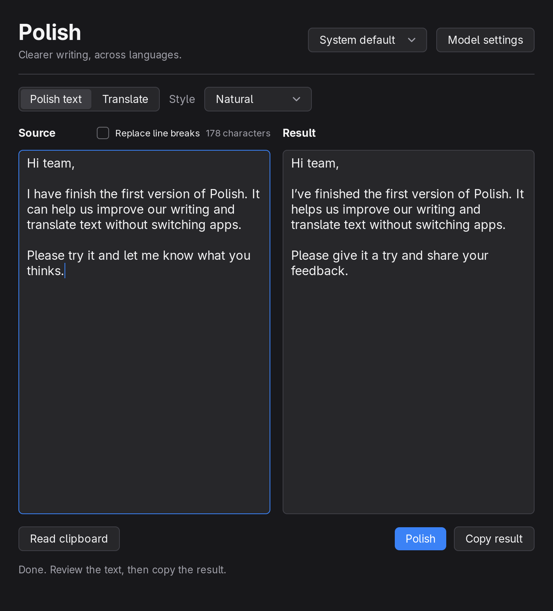
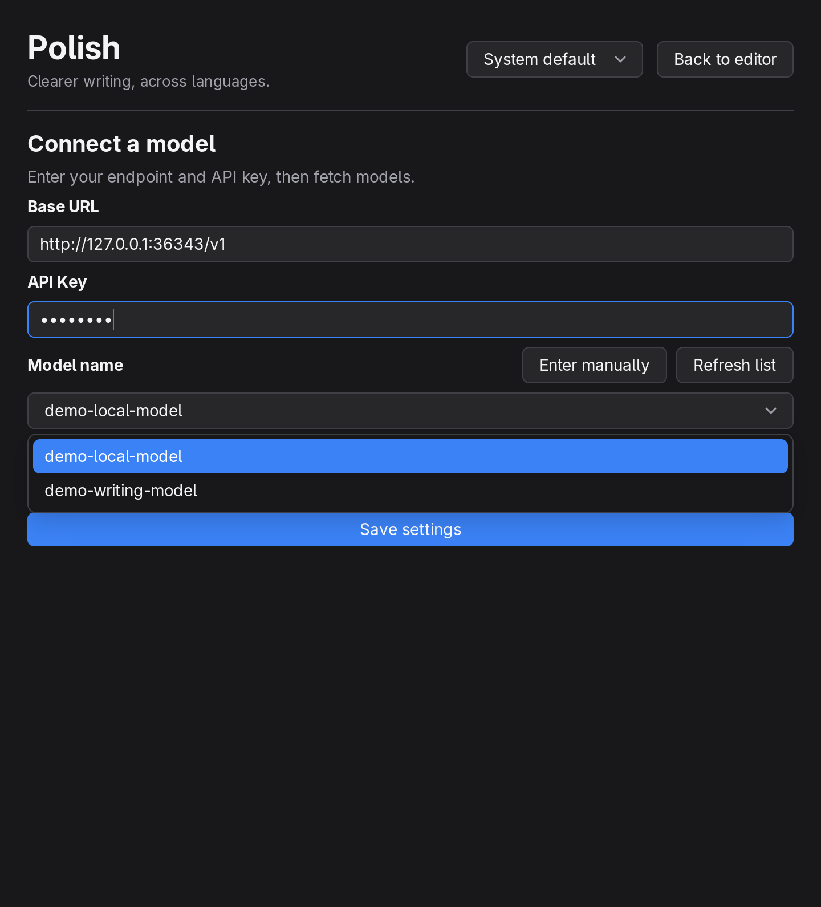
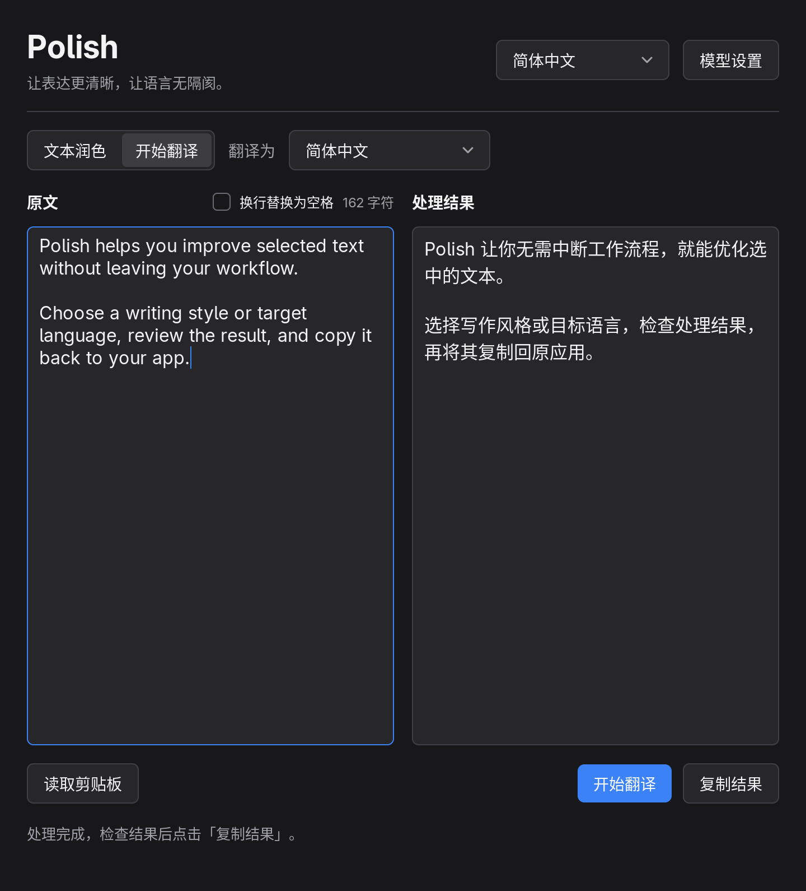

# Polish

A Linux desktop writing assistant built with **Go and MyGo native UI**. Capture selected text, polish or translate it with a language model, review the result, and copy it back to your application.

Features:

- Natural, formal, and concise polishing, preserving the original language.
- Translation into Simplified Chinese or English.
- English and Simplified Chinese interfaces, with a saved language preference.
- Wayland selection capture, explicit clipboard import, and manual editing.
- Optional conversion of source line breaks into spaces.
- OpenAI-compatible Chat Completions endpoints and model discovery.
- Cancelable background requests and a single application window.

## Screenshots

Captured from the native application using sample text and a local demo model service. The settings shown contain a dummy API key.

<p align="center">
  <a href="docs/screenshots/polishing.png" title="Polishing">
    
  </a>
  &nbsp;&nbsp;
  <a href="docs/screenshots/model-settings.png" title="Model settings">
    
  </a>
  &nbsp;&nbsp;
  <a href="docs/screenshots/translation-zh-Hans.png" title="Chinese interface and translation">
    
  </a>
</p>

## Requirements

- Go **1.27.3 or later**.
- A Linux Wayland desktop. Desktop integration is tested on Hyprland / Omarchy.
- GTK 3, GLib, Cairo, GdkPixbuf, Pango, and fonts for the languages you use.
- `wl-clipboard` for selection capture and copying results.
- Python 3 for the optional native smoke test.

MyGo loads system libraries through purego; CGo and WebKitGTK are not required for the native interface. No JavaScript or frontend build tools are needed.

## Build and run

```sh
make                         # Build bin/polish
make run                     # Build and launch
make run ARGS=--selection     # Capture the selection before opening
```

Equivalent Go commands:

```sh
go build -o bin/polish ./cmd/polish
./bin/polish
# Or run directly during development:
go run ./cmd/polish
```

## Install

```sh
make install
```

This runs `go install ./cmd/polish`. Go installs the executable into `GOBIN`, or the first `GOPATH` entry's `bin` directory when `GOBIN` is unset (usually `~/go/bin`). Add that directory to your `PATH` to run `polish` by name.

To choose another absolute installation directory:

```sh
GOBIN=/absolute/path/to/bin make install
```

## Configure a model

Open **Model settings** and enter:

| Setting | Description |
| --- | --- |
| Base URL | The service's API base URL, such as `https://api.example.com/v1` or a local HTTP endpoint. |
| API Key | The service's access key. |
| Model name | Click **Fetch models** and choose an ID, or enter a text-chat model ID manually. |

Click **Save settings** to apply the configuration. Requests use Bearer authentication and append `/chat/completions` to the base URL. The client expects non-streaming responses with text in `choices[0].message.content`. Requests time out after 60 seconds and can be canceled.

Model discovery uses `/models` under the base URL, with a 15-second timeout. You can refresh the list or enter a model manually if discovery is unsupported. Changing the endpoint or key clears the old list and cancels its request. Returned candidates do not guarantee account access or remaining quota.

### OpenCode

OpenCode uses separate model catalog endpoints. Polish maps its OpenAI base URLs to the appropriate catalog and filters the returned API metadata to retain models that support Chat Completions at the configured endpoint.

For OpenCode Go, use `https://opencode.ai/inference/go/openai/v1`. Polish sends a stable `x-opencode-session` for the running processing session and identifies itself as a desktop text editor through its User-Agent. The session header is not sent to other services. See the [OpenCode Go client requirements](https://dev.opencode.ai/v2/docs/console/go/#where-can-i-use-it).

### Storage and privacy

Settings are stored at `$XDG_CONFIG_HOME/polish/config.json`, or `~/.config/polish/config.json` when `XDG_CONFIG_HOME` is unset. The directory uses mode `0700`; the file uses `0600`.

**The API key is stored locally in plain text** and masked in the interface. Source text is sent only when you start processing. The application does not save text history or log source text, results, or keys.

## Interface language

The language selector in the window header offers **System default**, **English**, and **Simplified Chinese**. Changes apply immediately to labels, existing status messages, service errors, the window title, and MyGo controls. The preference is saved automatically, including before API setup.

System default checks `LANGUAGE`, `LC_ALL`, `LC_MESSAGES`, and `LANG` in that order. Chinese locale variants use Simplified Chinese; other unsupported languages fall back to English. An existing configuration without a `language` field follows the system. Command-line help and developer tooling use English.

Changing the interface language preserves source text, results, model selection, polishing style, and translation target. The interface language does not determine the language of model output.

## Usage

```sh
polish                  # Open the editor
polish --selection      # Capture the Wayland PRIMARY selection, then open or focus
```

1. Select text in another application and invoke your shortcut, or enter text manually.
2. Review the source, choose a polishing style or translation target, and start processing.
3. Review the result, click **Copy result**, and paste it into the original application.

`--selection` reads the Wayland **PRIMARY selection**, which differs from the regular Ctrl+C clipboard. The source application must publish a PRIMARY selection. Some browsers, editors, or terminals disable it, and PRIMARY may retain an earlier selection. Review the source before sending it.

Selection capture times out after two seconds. A failed capture clears the previous source and result and offers explicit clipboard import or manual entry. It never silently substitutes regular clipboard contents for the current selection.

### Replace line breaks

The **Replace line breaks** checkbox beside the source heading is off by default and saved automatically. Enabling it immediately converts line breaks in the current source into spaces. It also applies to subsequent selection capture, clipboard import, and source editing or pasting.

LF, CRLF, CR, and Unicode line breaks are handled; other spaces and tabs are preserved. Disabling the option preserves future line breaks but does not reconstruct text already converted. Model result formatting is unaffected.

### Window and request behavior

Repeated launches reuse the same window. A new selection or a change to source text or processing options cancels the old request and clears its result. Late responses cannot replace a newer result. Closing the window exits the application.

The first version does not include automatic replacement in other applications, a selection toolbar, OCR, a tray process, or text history.

## Hyprland / Omarchy shortcut example

Install the executable with `make install`. Check existing bindings before choosing an unused combination:

```sh
omarchy menu keybindings --print
```

Current Omarchy uses Lua configuration. Add an appropriate binding to `~/.config/hypr/bindings.lua`; replace the example executable path with your actual Go installation path:

```lua
-- Example shortcut: SUPER + ALT + P. Check that it is available first.
o.bind("SUPER + ALT + P", "Polish · Writing and translation", "polish --selection")
```

If you intentionally replace an existing shortcut, add the corresponding `hl.unbind(...)` before the new binding. Validate changes with:

```sh
hyprctl reload
hyprctl configerrors
```

Polish does not modify desktop configuration automatically.

## Development

| Command | Action |
| --- | --- |
| `make help` | List available targets. |
| `make build` | Build `bin/polish` (default target). |
| `make install` | Install into the Go bin directory. |
| `make run` | Build and run; accepts `ARGS`. |
| `make test` | Run package tests. |
| `make test-race` | Run tests with the race detector. |
| `make vet` | Run `go vet`. |
| `make fmt` | Format Go source files. |
| `make fmt-check` | Check formatting without modifying files. |
| `make check` | Run formatting, vet, and race checks. |
| `make e2e` | Build and run the native Wayland smoke test. |
| `make clean` | Remove only `bin/polish` and `bin/polish-e2e`. |

`GO`, `GOFMT`, and `PYTHON` can override the corresponding tool, for example `make e2e PYTHON=python3`.

Tests cover settings permissions, selection failures and timeouts, model requests and discovery, cancellation, stale-response isolation, line-break preferences, catalog coverage and formatting, language fallback and persistence, and both interface languages in light and dark themes at the minimum window size.

The native smoke test needs a running Wayland session. It uses temporary settings, a local mock model service, and mocked clipboard helpers. It verifies language switching and localized errors, model selection and persistence, source normalization, processing, copying, and single-instance behavior. It does not use real model credentials or overwrite the system clipboard. The test app is isolated from normal Polish instances and runs outside the source directory to verify embedded resources.

Screenshots are saved under `/tmp/polish-preview`, or the directory specified by `POLISH_TEST_ARTIFACTS`. Normal builds exclude the automation plugin; builds with the `e2e` tag listen on MyGo's local automation socket only when `MYGO_AUTOMATION` is set.

To query the currently configured service's real model list without sending source text or generating a response:

```sh
POLISH_LIVE_MODELS=1 go test ./internal/llm -run '^TestLiveModelList$' -v -timeout 30s
```

Mock tests do not establish a provider's compatibility or output quality. Use a valid service configuration for real polishing and translation checks.

## Project layout

```text
polish/
├── cmd/polish/              # CLI entry point and opt-in e2e integration
├── docs/screenshots/        # Native application screenshots used in this README
├── internal/
│   ├── app/                 # Lifecycle, task state, and native views
│   ├── config/              # Settings validation and persistence
│   ├── desktop/             # Wayland selection and clipboard adapters
│   ├── i18n/
│   │   └── locales/         # Embedded English and Simplified Chinese catalogs
│   └── llm/
│       └── prompts/         # Embedded Markdown prompt templates
├── scripts/smoke.py         # Native end-to-end verification
├── bin/                    # Ignored build outputs
├── Makefile
├── go.mod
├── go.sum
└── README.md
```

Tests live alongside their packages. `cmd/polish` handles arguments and exit status; application state and rendering are separated in `internal/app`. MyGo is pinned to `v0.7.4`; dependency versions and checksums are recorded in `go.mod` and `go.sum`.

## Edit prompts

Prompts live in `internal/llm/prompts/`:

| File | Purpose |
| --- | --- |
| `system.md` | Shared rules for preserving facts, treating the input as data, and returning only the result. |
| `polish-natural.md` | Natural polishing style. |
| `polish-formal.md` | Formal polishing style. |
| `polish-concise.md` | Concise polishing style. |
| `translate.md` | Translation; `{{.Target}}` becomes the selected target language's English name. |

Edit the relevant Markdown text. Translation uses Go's `text/template` syntax; preserve the `{{.Target}}` placeholder. Source text is sent as a separate user message and is never interpolated into the system prompt.

Prompt files are compiled into the binary with `go:embed`, so running the application does not require a resource directory or a particular working directory. Run `make check` and rebuild after edits; a running process does not reload templates automatically.

